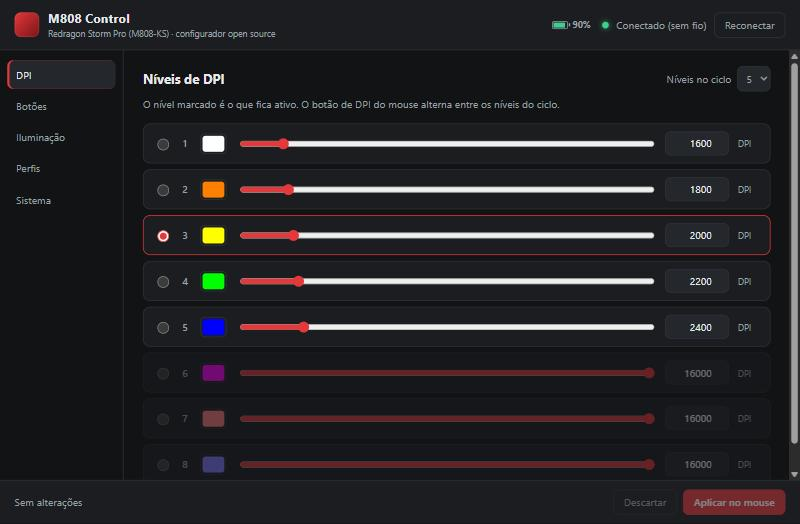
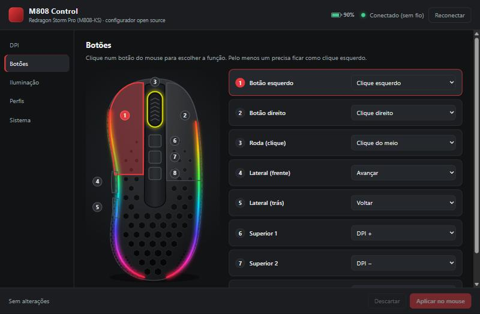
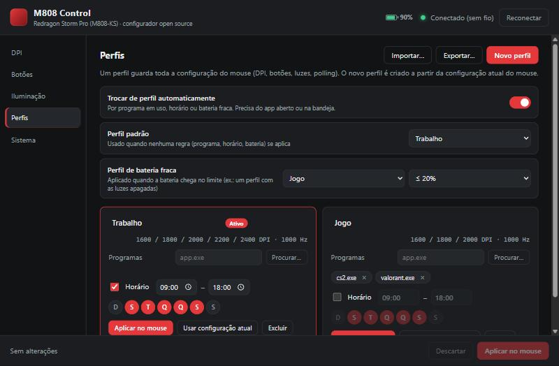

# M808 Control

**Configurador open source para o mouse Redragon Storm Pro (M808-KS)** — uma alternativa leve ao
software oficial (que só existe para Windows), com recursos que ele não tem.
Feito com [Tauri](https://tauri.app) (Rust + web).

🇺🇸 [Read in English](README.md)



> Projeto independente, sem relação com a Redragon. O protocolo foi obtido por engenharia reversa
> para fins de interoperabilidade — veja [docs/PROTOCOL.md](docs/PROTOCOL.md).

## Instalação (Windows)

Baixe o `*-setup.exe` da [última release](../../releases/latest) e execute.

O instalador ainda não tem assinatura digital, então o SmartScreen pode avisar: clique em
**Mais informações → Executar assim mesmo**. Feche o software oficial da Redragon antes — os dois
disputam a mesma conexão com o mouse.

A partir da versão 1.1, o app se atualiza sozinho.

## Recursos

| | |
|---|---|
|  |  |

- **DPI**: até 8 níveis (100–16000, passo 100), quantos entram no ciclo, nível ativo e cor de cada um
- **Botões**: vista de cima do mouse com os 8 botões — cliques, voltar/avançar, DPI +/−/ciclo,
  qualquer **tecla ou combinação** (Ctrl+Shift+Esc…), **teclas de mídia** (play/pause, volume…),
  troca de polling, liga/desliga luzes, reset de fábrica ou desativado
- **Faixa RGB lateral**: onda arco-íris, **onda colorida**, respiração, fixo ou desligado, com
  velocidade e brilho de 1 a 100% — **além dos limites do app oficial**
- **Faixa acompanhando a cor do DPI**: troque o nível no mouse e a faixa assume a cor dele
- **Luz da roda** (indicador de DPI): fixa, respiração ou desligada
- **Perfis** com troca automática pelo **programa em uso**, **horário** ou **bateria fraca**;
  exportar e importar perfis para compartilhar
- **Bateria** na janela e na bandeja, com aviso de bateria fraca
- **Ícone da bandeja** mostrando o DPI atual (na cor do nível) ou a bateria
- **Aviso na tela** ao trocar DPI, polling ou perfil
- **Polling rate** 125 / 250 / 500 / 1000 Hz
- **Backup e restauração** da memória do mouse (backup automático antes de gravar o botão de reset)
- **Inicia com o Windows** minimizado na bandeja; leve — fechar a janela destrói o WebView
- **Português e inglês**, layout responsivo, atualização automática

> As configurações ficam gravadas **no próprio mouse** — ele funciona igual com o app fechado.
> O app só precisa estar rodando para os perfis automáticos, a faixa sincronizada e o ícone da bandeja.


### O que este app faz e o oficial não

| | Oficial | M808 Control |
|---|:---:|:---:|
| Onda numa cor só na faixa lateral | — | ✅ |
| Velocidade/brilho além das 10 opções oficiais | — | ✅ |
| Faixa acompanhando a cor do nível de DPI | — | ✅ |
| Perfis por programa, horário ou bateria | — | ✅ |
| Bateria / DPI no ícone da bandeja | — | ✅ |
| Backup/restauração da memória do mouse | — | ✅ |
| Código aberto, interface em inglês, Linux | — | ✅ |
| Teclas, combinações e teclas de mídia nos botões | ✅ | ✅ |
| Macros | ✅ | 🚧 |

## Plataformas

| Sistema | Situação |
|---------|----------|
| Windows 10/11 | ✅ testado (receptor 2.4 GHz) |
| Linux | 🧪 experimental — `.deb`, `.rpm` e `.AppImage` nas releases; veja [docs/LINUX.md](docs/LINUX.md) |

## Compilar

Pré-requisitos: [Rust](https://rustup.rs), Node.js 20+ e, no Windows, Microsoft C++ Build Tools.

```bash
npm install
npm run tauri dev      # modo desenvolvimento
cd src-tauri && cargo test --lib   # testes do protocolo, perfis e ícone da bandeja
```

O `npm run tauri build` também gera os arquivos da atualização automática, que precisam ser assinados:
defina `TAURI_SIGNING_PRIVATE_KEY` (e `TAURI_SIGNING_PRIVATE_KEY_PASSWORD`) com a sua chave
(`npx tauri signer generate`), ou use `"createUpdaterArtifacts": false` em `src-tauri/tauri.conf.json`
para um build local.

Releases: crie uma tag `vX.Y.Z` e o GitHub Actions compila, assina e cria o rascunho da release.

## Licença

[MIT](LICENSE)
